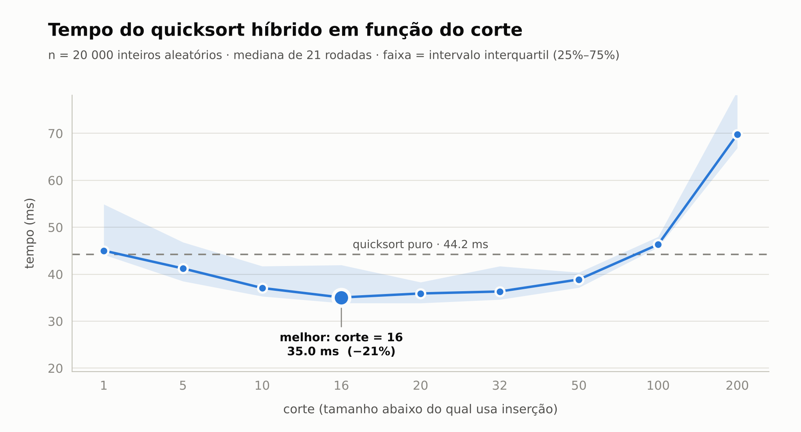
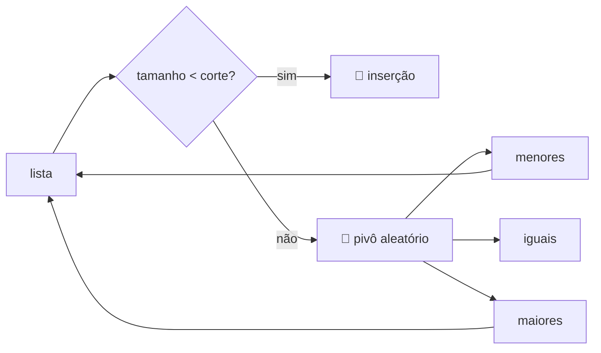
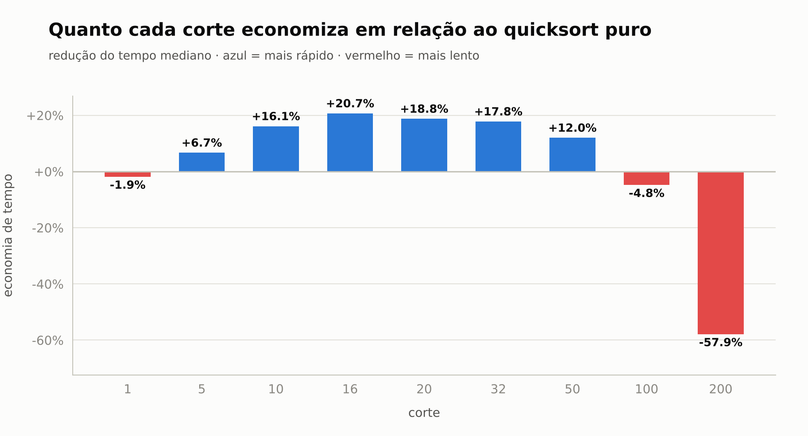
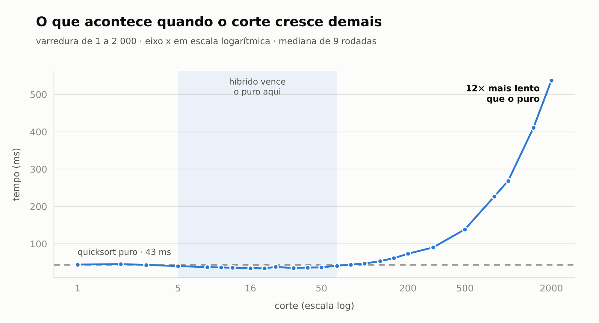
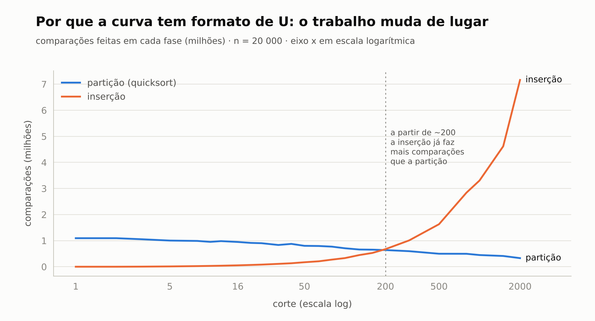

<div align="center">

# ⚡ Quicksort Híbrido

**Quicksort para os pedaços grandes, inserção para os pequenos — e onde fica o ponto de troca.**

👥 Arthur Gabriel Monteiro Barreiras · Cauã Evaristo da Cruz


[Relatório completo](RELATORIO.md) · [Código](src/ordenacao.py) · [Benchmark](src/benchmark.py) · [Dados brutos](resultados/)

</div>

---

<picture>
  <source media="(prefers-color-scheme: dark)" srcset="graficos/tempo_por_corte_escuro.png">
  
</picture>

## 🎯 Resultado em 30 segundos

| | |
|---|---|
| 🏆 **Melhor corte** | **16** → 35,0 ms |
| 🐢 Quicksort puro | 44,2 ms |
| 📉 **Ganho** | **20,7 % menos tempo (1,26× mais rápido)** |
| ✅ Faixa boa | qualquer corte entre **10 e 50** ganha do puro |
| 💥 Corte grande demais | corte 200 já é 58 % mais lento; corte 2 000 é **12× mais lento** |
| 🟰 Corte = 1 | idêntico ao puro: mesmas 26 569 chamadas, **0** comparações de inserção |

*20 000 inteiros aleatórios · mediana de 21 rodadas · CPython 3.13*

## 🧠 A ideia

O quicksort é O(n log n), mas cada chamada tem um custo fixo alto (sortear pivô, criar três listas, duas chamadas recursivas, concatenar). A inserção é O(n²), mas quase não tem custo fixo. Para pedaços pequenos, a inserção ganha — e é por isso que bibliotecas reais (`std::sort` do C++, `Arrays.sort` do Java, `Array.Sort` do .NET) combinam os dois.



## ✅ Tarefas

- [x] **1.** Quicksort com pivô aleatório, separando em menores, iguais e maiores → [`quicksort_puro`](src/ordenacao.py)
- [x] **2.** Versão que chama a inserção quando o pedaço tem menos que `corte` elementos → [`quicksort_hibrido(v, corte)`](src/ordenacao.py)
- [x] **3.** Tempo com 20 mil elementos para cortes 1, 5, 10, 16, 20, 32, 50, 100 e 200 → [`benchmark.py`](src/benchmark.py)
- [x] **4.** Comparação com o quicksort puro → [tabela](RELATORIO.md#3-tabela-de-resultados)
- [x] **5.** Gráfico do tempo em função do corte → [gráficos](RELATORIO.md#4-gráfico-tempo--corte)

**Extras:** varredura de 1 a 2 000, contagem de comparações por fase, gráficos com tema claro/escuro, testes automatizados e CI no GitHub Actions.

## 📊 Mais gráficos

<table>
<tr>
<td width="50%">
<picture>
  <source media="(prefers-color-scheme: dark)" srcset="graficos/ganho_por_corte_escuro.png">
  
</picture>
</td>
<td width="50%">
<picture>
  <source media="(prefers-color-scheme: dark)" srcset="graficos/varredura_estendida_escuro.png">
  
</picture>
</td>
</tr>
<tr>
<td colspan="2">
<picture>
  <source media="(prefers-color-scheme: dark)" srcset="graficos/operacoes_escuro.png">
  
</picture>
</td>
</tr>
</table>

## 🚀 Como rodar

```bash
git clone https://github.com/Arthur-Gmb/quicksort-hibrido.git
cd quicksort-hibrido
pip install -r requirements.txt

python -m unittest discover -s tests -v   # testes de corretude
python src/benchmark.py                   # medição completa (~40 s)
python src/graficos.py                    # gera os gráficos em graficos/
```

> Quer só testar se tudo funciona? `python src/benchmark.py --rapido` roda em poucos segundos.

## 📁 Estrutura

```
quicksort-hibrido/
├── src/
│   ├── ordenacao.py      # inserção, quicksort puro e híbrido
│   ├── benchmark.py      # medição de tempo + contagem de operações
│   └── graficos.py       # gráficos (versões clara e escura)
├── tests/
│   └── test_ordenacao.py # corretude para todos os cortes e casos-limite
├── resultados/           # tempos brutos (CSV), operações (CSV) e resumo (JSON)
├── graficos/             # PNGs usados no README e no relatório
├── RELATORIO.md          # análise completa
└── .github/workflows/    # CI: roda os testes a cada push
```

## 🔍 Peculiaridades (resumo)

1. **O ótimo é uma faixa, não um número.** 16, 20 e 32 ficam a menos de 1,3 ms um do outro — menos que o ruído da medição.
2. **Corte = 1 e corte = 2 são idênticos ao puro**: a inserção só recebe listas com 0 ou 1 elemento, que já estão ordenadas.
3. **Em Python o ótimo tende a ser menor** que em C/Java, porque o `while` da inserção é interpretado passo a passo, enquanto a partição usa compreensões de lista enxutas.
4. **A partição em três listas faz 3·n comparações por nível** — é cara, e por isso cortar os níveis de baixo rende tanto.
5. **Corte grande faz a inserção dominar**: perto de 200 ela já faz mais comparações que toda a partição.

Detalhes, tabelas e explicações no **[RELATORIO.md](RELATORIO.md)**.

---

<div align="center">
<sub>Feito por <b>Arthur Gabriel Monteiro Barreiras</b> e <b>Cauã Evaristo da Cruz</b> · Ciência da Computação</sub>
</div>
