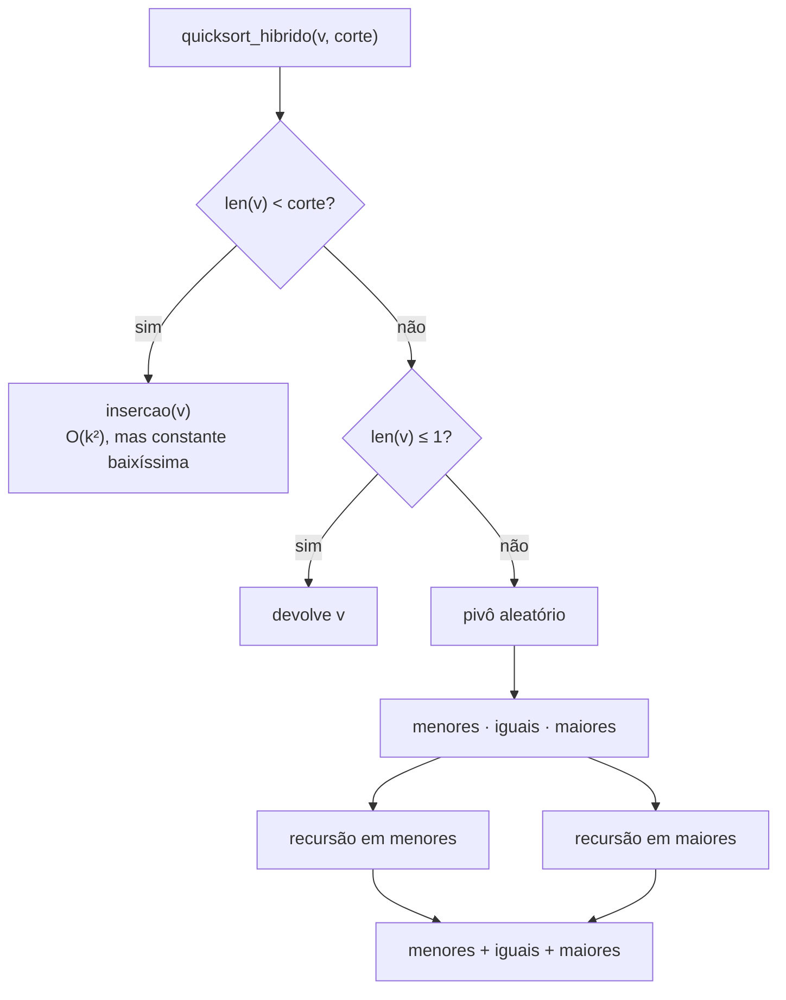

# Relatório — Quicksort híbrido: onde fica o ponto de troca?

**Dupla:** Arthur Gabriel Monteiro Barreiras · Cauã Evaristo da Cruz

> **Resumo:** com 20 000 inteiros aleatórios, o melhor corte foi **16**, com **35,0 ms** contra **44,2 ms** do quicksort puro — **20,7 % menos tempo (1,26× mais rápido)**. A faixa de 10 a 50 é praticamente um platô: todos esses cortes ganham do puro. Acima de ~100 o híbrido passa a perder, e com corte 2 000 fica **12× mais lento**. Com corte = 1 o algoritmo faz exatamente o mesmo trabalho que o puro.

---

## Sumário

1. [O que foi implementado](#1-o-que-foi-implementado)
2. [Como foi medido](#2-como-foi-medido)
3. [Tabela de resultados](#3-tabela-de-resultados)
4. [Gráfico: tempo × corte](#4-gráfico-tempo--corte)
5. [Melhor corte e ganho sobre a rápida pura](#5-melhor-corte-e-ganho-sobre-a-rápida-pura)
6. [O que acontece com cortes grandes demais](#6-o-que-acontece-com-cortes-grandes-demais)
7. [Confirmação: corte = 1 se comporta como a rápida pura](#7-confirmação-corte--1-se-comporta-como-a-rápida-pura)
8. [Peculiaridades observadas](#8-peculiaridades-observadas)
9. [Conclusão](#9-conclusão)

---

## 1. O que foi implementado

Todo o código está em [`src/ordenacao.py`](src/ordenacao.py).

### 1.1 Quicksort puro (tarefa 1)

```python
def quicksort_puro(v):
    if len(v) <= 1:
        return list(v)
    pivo = random.choice(v)                     # pivô aleatório
    menores = [x for x in v if x < pivo]
    iguais  = [x for x in v if x == pivo]
    maiores = [x for x in v if x > pivo]
    return quicksort_puro(menores) + iguais + quicksort_puro(maiores)
```

* **Pivô aleatório** — evita o pior caso O(n²) em entradas já ordenadas ou invertidas; o custo esperado é O(n log n) para qualquer entrada.
* **Três listas (menores / iguais / maiores)** — os elementos iguais ao pivô já ficam na posição final e não entram mais na recursão. Isso deixa o algoritmo robusto a muitas repetições (com só duas listas, uma lista de valores todos iguais cairia em O(n²)).

### 1.2 Quicksort híbrido (tarefa 2)

```python
def quicksort_hibrido(v, corte):
    if len(v) < corte:                          # pedaço pequeno → inserção
        return insercao(v)
    if len(v) <= 1:
        return list(v)
    pivo = random.choice(v)
    menores = [x for x in v if x < pivo]
    iguais  = [x for x in v if x == pivo]
    maiores = [x for x in v if x > pivo]
    return quicksort_hibrido(menores, corte) + iguais + quicksort_hibrido(maiores, corte)
```

A única diferença é a primeira linha: quando o pedaço tem **menos que `corte`** elementos, ele é entregue à ordenação por inserção, e a recursão para ali.



### 1.3 Por que a combinação funciona

| | Quicksort | Inserção |
|---|---|---|
| Complexidade | O(n log n) esperado | O(n²) |
| Custo fixo por chamada | **alto**: 3 listas novas, sorteio do pivô, 2 chamadas recursivas, concatenação | **baixo**: só um laço sobre a própria lista |
| Bom para | pedaços grandes | pedaços pequenos |

Em listas pequenas, n² ainda é um número pequeno, e o custo fixo do quicksort domina. Trocar de algoritmo nesse ponto corta justamente as milhares de chamadas recursivas no "pé" da árvore — onde está a maior parte delas.

---

## 2. Como foi medido

Script: [`src/benchmark.py`](src/benchmark.py). Os números brutos estão em [`resultados/`](resultados/).

| Item | Valor |
|---|---|
| Tamanho da entrada | 20 000 inteiros aleatórios entre 0 e 10⁹ |
| Cortes testados | 1, 5, 10, 16, 20, 32, 50, 100, 200 + quicksort puro |
| Rodadas | 21 (experimento principal) + 9 (varredura estendida de 1 a 2 000) |
| Estatística reportada | **mediana** (também guardamos mínimo, média e desvio-padrão) |
| Ambiente | CPython 3.13, Linux x86-64 |

Cuidados para a comparação ser justa:

* **Mesma entrada para todos.** Em cada rodada é gerada uma lista nova, e *todas* as configurações ordenam essa mesma lista.
* **Mesmos pivôs.** A semente do `random` é refeita antes de cada configuração, então o puro e o híbrido sorteiam a mesma sequência de pivôs.
* **Ordem embaralhada.** A ordem em que as configurações rodam muda a cada rodada, para que aquecimento de cache/CPU não favoreça sempre a mesma.
* **Coletor de lixo desligado** durante a medição (`gc.disable()`), já que o algoritmo cria muitas listas temporárias e uma coleta no meio distorceria um tempo isolado.
* **Mediana em vez de média**, porque é robusta a picos causados pelo sistema operacional.
* **Cada resultado é conferido** contra `sorted()` — nenhum tempo entra na tabela se a ordenação estiver errada.

---

## 3. Tabela de resultados

**n = 20 000, mediana de 21 rodadas**

| Configuração | Mediana (ms) | Mínimo (ms) | Desvio-padrão (ms) | Economia vs. puro | Aceleração |
|:---|---:|---:|---:|---:|---:|
| **Quicksort puro** | **44,19** | 41,15 | 7,47 | — | 1,00× |
| corte = 1 | 45,03 | 42,92 | 6,57 | −1,9 % | 0,98× |
| corte = 5 | 41,23 | 36,82 | 5,49 | +6,7 % | 1,07× |
| corte = 10 | 37,06 | 34,10 | 6,66 | +16,1 % | 1,19× |
| 🏆 **corte = 16** | **35,05** | 32,43 | 5,62 | **+20,7 %** | **1,26×** |
| corte = 20 | 35,90 | 32,27 | 4,18 | +18,8 % | 1,23× |
| corte = 32 | 36,32 | 33,53 | 4,39 | +17,8 % | 1,22× |
| corte = 50 | 38,88 | 35,04 | 5,77 | +12,0 % | 1,14× |
| corte = 100 | 46,32 | 44,26 | 5,05 | −4,8 % | 0,95× |
| corte = 200 | 69,79 | 63,91 | 6,98 | −57,9 % | 0,63× |

*Economia positiva = mais rápido que o puro; negativa = mais lento.*

---

## 4. Gráfico: tempo × corte

<picture>
  <source media="(prefers-color-scheme: dark)" srcset="graficos/tempo_por_corte_escuro.png">
  
</picture>

A curva tem o formato clássico de **U**: cai enquanto a inserção elimina chamadas recursivas caras, atinge um vale largo entre 10 e 50 e sobe quando a inserção passa a receber pedaços grandes demais.

<picture>
  <source media="(prefers-color-scheme: dark)" srcset="graficos/ganho_por_corte_escuro.png">
  
</picture>

---

## 5. Melhor corte e ganho sobre a rápida pura

**O melhor corte foi 16**: 35,05 ms contra 44,19 ms do quicksort puro.

* Economia de **9,1 ms por ordenação**, ou seja **20,7 % menos tempo**.
* Em termos de aceleração: **1,26×** mais rápido.

Um cuidado importante na leitura: a diferença entre 16, 20 e 32 (35,1 / 35,9 / 36,3 ms) é **menor que o desvio-padrão** das medições (~4–6 ms). Na varredura estendida, feita com outras entradas, o mínimo caiu no corte 20 (34,2 ms). A conclusão honesta é que **o ponto ótimo é uma faixa, e não um número exato — algo entre 16 e 32** — e que qualquer corte entre 10 e 50 já entrega a maior parte do ganho.

Curiosamente, 16 é o mesmo limite usado pelo `std::sort` da biblioteca padrão do C++ (GCC/libstdc++) e pelo `Array.Sort` do .NET. O Java usa um valor maior (na casa de 40–50) no seu quicksort de dois pivôs.

---

## 6. O que acontece com cortes grandes demais

<picture>
  <source media="(prefers-color-scheme: dark)" srcset="graficos/varredura_estendida_escuro.png">
  
</picture>

| Corte | 100 | 200 | 300 | 500 | 1 000 | 2 000 |
|---|---:|---:|---:|---:|---:|---:|
| Tempo (ms) | 47 | 73 | 90 | 139 | 269 | 537 |
| vs. puro (43 ms) | 1,1× | 1,7× | 2,1× | 3,2× | 6,2× | **12,5×** |

Quando o corte cresce demais, **a inserção passa a receber pedaços grandes, e o custo quadrático dela aparece**. Ordenar um pedaço de *k* elementos por inserção custa em média ~*k*²/4 comparações. Como a entrada inteira acaba dividida em pedaços de tamanho próximo do corte, o trabalho total da inserção cresce **linearmente com o corte** (≈ n·k/4) — e deixa de ser compensado pela economia de chamadas recursivas.

O gráfico abaixo mostra isso pela contagem de comparações (script em `src/benchmark.py`, função `contar_operacoes`):

<picture>
  <source media="(prefers-color-scheme: dark)" srcset="graficos/operacoes_escuro.png">
  
</picture>

| Corte | Chamadas recursivas | Comparações na partição | Comparações na inserção |
|---:|---:|---:|---:|
| 1 | 26 569 | 1 093 824 | **0** |
| 16 | 4 643 | 949 218 | 53 208 |
| 50 | 1 581 | 801 381 | 171 423 |
| 200 | 403 | 638 559 | 673 758 |
| 2 000 | 33 | 329 442 | 7 161 209 |

* De 1 para 16 o número de chamadas cai **5,7×** (26 569 → 4 643), e a inserção faz só 53 mil comparações — troca muito vantajosa.
* Perto de **corte = 200**, a inserção já faz **mais comparações do que toda a partição**. É exatamente onde o tempo dispara.
* No extremo, se o corte for maior que o tamanho da lista, o "híbrido" vira **inserção pura, O(n²)**: para 20 000 elementos seriam ~100 milhões de comparações — segundos em vez de milissegundos.

> O tempo começa a piorar (a partir de ~64) **antes** de as comparações da inserção ultrapassarem as da partição (~200). Isso acontece porque, em Python, uma comparação dentro do `while` da inserção custa mais do que uma comparação dentro de uma compreensão de lista (ver [peculiaridade 8.1](#81-o-ponto-ótimo-depende-da-linguagem)).

---

## 7. Confirmação: corte = 1 se comporta como a rápida pura

A confirmação foi feita de três formas independentes:

**a) Pela lógica do código.** A condição de troca é `len(v) < corte`. Com `corte = 1`, ela só é verdadeira para `len(v) = 0`, isto é, para a **lista vazia**. A inserção nunca recebe nenhum elemento para ordenar; a recursão segue exatamente o mesmo caminho do puro.

**b) Pela contagem de operações (mesma entrada, mesmos pivôs):**

| | Quicksort puro | Híbrido, corte = 1 |
|---|---:|---:|
| Chamadas recursivas | 26 569 | 26 569 |
| Comparações na partição | 1 093 824 | 1 093 824 |
| Comparações na inserção | — | **0** |

Mesma árvore de recursão, mesmo número de comparações, zero trabalho de inserção. Há também um teste automatizado (`test_corte_1_nunca_usa_insercao`) que intercepta a função `insercao` e verifica que todas as chamadas recebem listas de tamanho 0.

**c) Pelo tempo.** 45,03 ms contra 44,19 ms: diferença de **0,8 ms (1,9 %)**, bem dentro do desvio-padrão (~7 ms). Estatisticamente é o mesmo tempo.

O pequeno excesso que aparece de forma consistente tem explicação: o híbrido faz uma comparação `len(v) < corte` a mais em cada chamada e, quando o pedaço é vazio, chama `insercao([])` em vez de devolver direto — são **6 569 chamadas extras de função para listas vazias**. É um custo fixo minúsculo, não uma diferença de algoritmo.

> Detalhe: **corte = 2 também é equivalente ao puro**. Ele manda listas de 0 e 1 elemento para a inserção, que já estão ordenadas por definição — por isso a contagem de comparações da inserção continua zero.

---

## 8. Peculiaridades observadas

### 8.1 O ponto ótimo depende da linguagem

Em Python, a partição é feita com **compreensões de lista**, que rodam um laço bem enxuto no interpretador. Já a inserção usa um `while` com índices, atribuições e comparações explícitas — várias instruções de bytecode por passo. Ou seja, em Python cada passo da inserção é *relativamente* mais caro do que seria em C ou Java. Isso empurra o ponto ótimo para valores menores e faz o tempo começar a subir antes de a contagem de comparações sugerir. Em outra linguagem, o mesmo experimento poderia dar um ótimo diferente.

### 8.2 A partição em três listas percorre o pedaço três vezes

Cada nível faz três passadas (`<`, `==`, `>`), ou seja **3·n comparações por nível**, contra ~n de uma partição *in-place* clássica (Lomuto/Hoare). Em troca, o código fica simples e os valores repetidos são tratados de graça. Isso também explica por que o híbrido ajuda tanto aqui: quanto mais cara a partição, mais vale a pena evitá-la nos pedaços pequenos.

### 8.3 Não é *in-place*

Cada chamada cria listas novas e devolve uma lista nova (a entrada original nunca é modificada — há teste para isso). Gasta mais memória que a versão clássica, mas é a forma pedida na atividade e a mais fácil de ler.

### 8.4 Ruído de medição é grande

Mesmo com GC desligado e mediana de 21 rodadas, o desvio-padrão fica entre 4 e 7 ms (10–17 % do tempo). Por isso a seção 5 trata o ótimo como faixa. Foi essa a razão para:

* usar a **mesma entrada e os mesmos pivôs** em todas as configurações de uma rodada (a comparação fica pareada);
* embaralhar a **ordem** das configurações;
* mostrar no gráfico a **faixa interquartil**, não só a mediana.

### 8.5 A partição também fica mais barata com corte maior

Na tabela de operações, as comparações da partição caem de 1,09 milhão (corte 1) para 0,33 milhão (corte 2 000). Faz sentido: a árvore de recursão para mais cedo, perdendo cerca de log₂(corte) níveis. O problema é que o que se economiza ali é muito menor do que o que a inserção passa a gastar.

### 8.6 Muitas chamadas pequenas, e não uma inserção final

Nesta implementação a inserção é chamada em **cada** pedaço pequeno (2 322 vezes com corte 16). Existe uma variante clássica (Sedgewick) que deixa os pedaços pequenos desordenados e faz **uma única** passada de inserção na lista inteira no final — como cada elemento já está a menos de `corte` posições do seu lugar, essa passada é praticamente linear. Seria um próximo experimento interessante.

---

## 9. Conclusão

* A combinação quicksort + inserção **funciona**: o melhor corte (16) reduziu o tempo em **20,7 %** sobre o quicksort puro.
* O ganho é robusto: **qualquer corte entre 10 e 50** deu pelo menos 12 % de economia.
* Corte pequeno demais não ganha nada (**corte = 1 é idêntico ao puro**), e corte grande demais é desastroso: a partir de ~100 o híbrido perde, e com 2 000 fica 12× mais lento, porque o O(k²) da inserção volta a dominar.
* O resultado bate com a prática das bibliotecas reais, que usam limites na casa de 16 a 50.

---

<sub>Para reproduzir: `python src/benchmark.py && python src/graficos.py`. Os números exatos variam de máquina para máquina, mas o formato da curva e a faixa ótima se mantêm.</sub>
